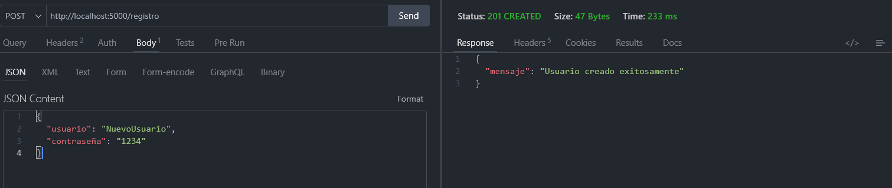
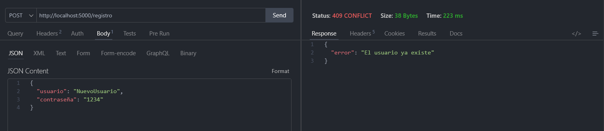
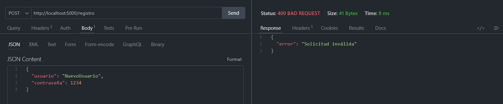
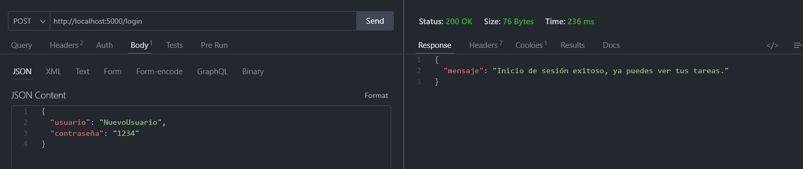
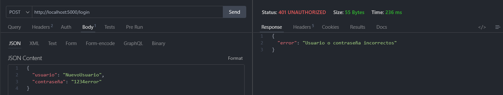
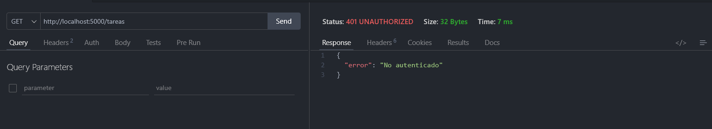
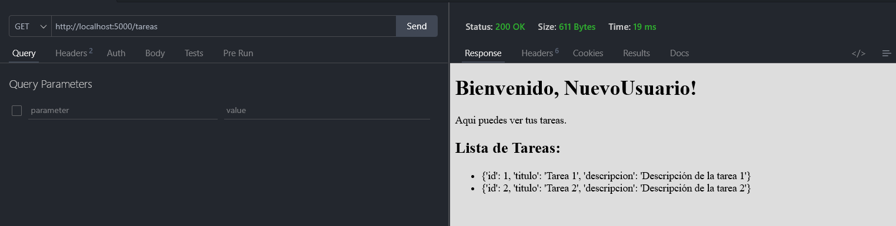
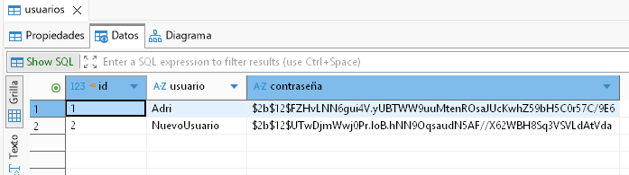

# PFO 2: Sistema de Gestión de Tareas con API y Base de Datos

API REST hecha con Flask y SQLite que permite registrar usuarios, iniciar sesión y acceder a una página de bienvenida protegida. Las contraseñas se guardan hasheadas con bcrypt.

## Tecnologías

- Python 3
- Flask
- SQLite (módulo `sqlite3`)
- bcrypt (hash de contraseñas)
- python-dotenv (variables de entorno)

## Estructura del proyecto

```
pfo2/
├── servidor.py          # API Flask + SQLite
├── cliente.py           # Cliente para probar la API
├── templates/
│   └── bienvenida.html  # Página de bienvenida de /tareas
├── capturas/            # Capturas de pantalla de las pruebas
├── requirements.txt
├── .env.example
├── .gitignore
└── README.md
```

## Instalación y ejecución

1. Clonar el repositorio:

   ```bash
   git clone https://github.com/adco23/PSR-PFO2-gestion-tareas.git
   cd pfo2
   ```

2. Crear y activar un entorno virtual:

   ```bash
   python -m venv venv
   
   venv\Scripts\activate
   ```

3. Instalar las dependencias:

   ```bash
   pip install -r requirements.txt
   ```

4. Crear el archivo `.env` a partir del ejemplo:

   ```bash
   cp .env.example .env
   ```

   Y completar los valores:

   ```
   SECRET_KEY=una_clave_larga_y_aleatoria
   DEBUG_MODE=False
   ```

   Para generar una clave segura:

   ```bash
   python -c "import secrets; print(secrets.token_hex(32))"
   ```

   Si no se define `SECRET_KEY`, la app genera una aleatoria al arrancar (las sesiones se pierden al reiniciar).

5. Iniciar el servidor:

   ```bash
   python servidor.py
   ```

   El servidor queda disponible en `http://127.0.0.1:5000`. La base de datos `tareas.db` se crea automáticamente.

6. Probar la API con el cliente en una terminal separada:

   ```bash
   python cliente.py
   ```

   Muestra un menú para registrarse, iniciar sesión, ver tareas y cerrar sesión.

## Endpoints

| Método | Ruta | Descripción | Respuestas |
|---|---|---|---|
| GET | `/` | Mensaje de bienvenida de la API | 200 |
| POST | `/registro` | Registra un usuario | 201, 400, 409 |
| POST | `/login` | Inicia sesión | 200, 400, 401 |
| POST | `/logout` | Cierra la sesión | 200 |
| GET | `/tareas` | Página HTML de bienvenida (requiere login) | 200, 401 |

Formato del body para `/registro` y `/login`:

```json
{"usuario": "nombre", "contraseña": "1234"}
```

## Cómo probarlo

Se puede usar curl, Postman o Thunder Client. Con curl, guardando la cookie de sesión:

```bash
# Registro
curl -i -X POST http://127.0.0.1:5000/registro \
  -H "Content-Type: application/json" \
  -d '{"usuario": "ana", "contraseña": "1234"}'

# Login (guarda la cookie de sesión)
curl -i -c cookies.txt -X POST http://127.0.0.1:5000/login \
  -H "Content-Type: application/json" \
  -d '{"usuario": "ana", "contraseña": "1234"}'

# Tareas (usa la cookie)
curl -i -b cookies.txt http://127.0.0.1:5000/tareas

# Logout
curl -i -b cookies.txt -c cookies.txt -X POST http://127.0.0.1:5000/logout
```

Usando el cliente `cliente.py`, se pueden ejecutar todas las pruebas de registro, login y acceso a `/tareas` de forma automática.


## Capturas de pantalla

> Reemplazar los nombres por las capturas reales guardadas en `capturas/`.

| Prueba | Resultado esperado | Captura |
|---|---|---|
| Registro exitoso | 201 |  |
| Usuario duplicado | 409 |  |
| Body inválido | 400 |  |
| Login correcto | 200 |  |
| Login incorrecto | 401 |  |
| `/tareas` sin login | 401 |  |
| `/tareas` con login | 200 + HTML |  |
| Contraseña hasheada en la base | Hash, no texto plano |  |

## Seguridad

- Las contraseñas se almacenan con bcrypt (hash con salt), nunca en texto plano.
- Las consultas SQL son parametrizadas, lo que previene SQL injection.
- El login devuelve el mismo mensaje si falla el usuario o la contraseña.
- La clave de sesión se lee de una variable de entorno y `.env` no se sube al repositorio.

## Respuestas conceptuales

### ¿Por qué hashear contraseñas?

Para no guardar nunca la contraseña original. Si la base de datos se filtra, el atacante solo obtiene hashes, que no se pueden revertir directamente, en lugar de las contraseñas reales. Además, como muchas personas reutilizan contraseñas, una filtración en texto plano comprometería también sus cuentas en otros sitios. Con un algoritmo como bcrypt, que agrega un salt aleatorio y es deliberadamente lento, dos usuarios con la misma contraseña tienen hashes distintos y los ataques de fuerza bruta se vuelven costosos.

### Ventajas de usar SQLite en este proyecto

- No requiere instalar ni administrar un servidor de base de datos.
- Toda la base se guarda en un único archivo (`tareas.db`).
- Viene incluido en Python mediante el módulo `sqlite3`.
- Es liviano y suficiente para el volumen de datos de un proyecto pequeño.
- Facilita ejecutar y probar el proyecto en cualquier máquina.

## Autora

Adriana Coronel